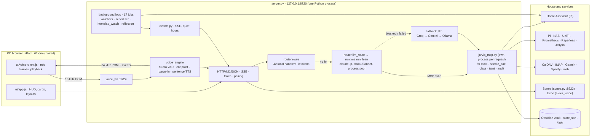

# Architecture

```
Browser HUD (ui/)  ──HTTP/NDJSON──▶  server.py (127.0.0.1:8720)
   mic, speech, graph                 │
   bell, views          ◀──SSE──  events.py  ◀── watchers, homelab_watch, scheduler, learning modules
                                      │
                         router.py ───┼──▶ local handlers (0 tokens): home, timers, lists, routines,
                                      │      windows, personality, emergency stop, weather, …
                                      └──▶ lean Claude call (runtime.py)  ──MCP stdio──▶ jarvis_mcp.py
                                            └─ fallback_llm.py (Groq → Gemini → Ollama) ──▶ jarvis_mcp.py
```

## Current state (Mermaid)



The target architecture for the planned expansion (plugin registry, YAML configuration, SQLite memory index,
event engine, Linux server with a PC agent) is drawn in `BESTANDSAUFNAHME.md`, section 9; `ROADMAP.md` tracks
the status of each phase.

## Request path

1. `server.py` receives `/api/run` (typed flag from the input field).
2. `router.route` tries the local handlers in order (`LOCAL_HANDLERS`). A hit answers immediately.
3. Otherwise `router.llm_route` picks tool groups by regex and the model (Haiku/Sonnet).
4. `commands.lean_system` builds a short system prompt (persona from `personality.py`, rules from
   `policy.py`/`privacy.py`, learned rules from `reflection.py`, core notes); `commands.lean_prefix`
   adds time, the last exchanges, matching notes, open proposals.
5. `runtime.run_lean` runs `claude -p` with only those tool groups (`jarvis_mcp.py` as MCP server).
   If Claude is blocked or fails before speaking, `fallback_llm.run` uses the free chain with the
   same tools.
6. Every tool call goes through `jarvis_mcp.handle_call`: action class, block list, taint check,
   audit log, size cap, untrusted wrapping. CONFIRM tools reach the HUD card via `/api/permission/request`.

## Layout

`server.py` (entry point) and `paths.py` stay in the root. All other modules live in `jarvis/<group>/` and keep
their short import names (`import memory`, `import router`): `paths.py` puts every group folder on `sys.path`.
Entry points import it first — `server.py`, `jarvis/tools/jarvis_mcp.py` (started as its own process by Claude
Code and the stand-ins), `tests/isolate.py`, the scripts. Modules find the repository (config, logs, vault, ui)
via `Path(__file__).resolve().parents[2]`, never via their own folder.

## Modules

| Area | Modules |
|---|---|
| Core (`jarvis/core`) | `server.py` (root), `router.py`, `runtime.py`, `commands.py`, `events.py`, `scheduler.py`, `background.py`, `hostos.py` (what differs between Windows and Linux, PORTING.md), `jarvis_log.py` (JSON log, warnings counted), `metrics.py` (registry behind `/metrics`) |
| Tools | `jarvis_mcp.py` (MCP server; `call_tool` = dispatch, `handle_call` = policy wrapper) |
| Safety | `policy.py`, `audit.py`, `emergency.py`, `privacy.py`, `proposals.py` |
| Memory | `memory.py` (vault, graph, diary), `memory_tools.py` (provenance, forget, export, backup), `answer_cache.py`, `learning.py` |
| Voice engine | `voice_engine.py` (one Session per microphone: state machine IDLE→LISTENING→THINKING→SPEAKING→INTERRUPTED/RESUMING, adaptive endpoint, barge-in classification, resume at sentence start, the spoken part into the window), `voice_ws.py` (WebSocket 127.0.0.1:8724, 16-kHz frames in, 24-kHz PCM + JSON events out), `voice_vad.py` (Silero VAD v5 via onnxruntime, energy fallback), `voice_endpoint.py` (completeness rules, learned wait, turn-model hook), `voice_stt.py` (partials and finals on the faster-whisper model), `voice_tts.py` (sentence splitter, per-sentence synthesis kept for resume), `voice_dsp.py` (resample, fades, decoder, echo guard, delay estimate), `voice_wake.py`, `voice_state.py`, `voice_metrics.py` (jsonl + `/metrics`), `voice_config.py` (`config/voice.yaml`); the browser side is `ui/voice-client.js` |
| Voice | `voice.py`, `tts_chain.py`, `local_tts_server.py`, `wakeword.py`, `ambience.py` (music/sport/TV playing, from Home Assistant), `pronounce.py`, `sonos.py` (a device's answers as a Home Assistant announcement on a Sonos; clip server on the LAN), `alexa_voice.py` (a device's answers read aloud by an Echo, sentence after sentence) |
| Personality | `personality.py` |
| Proactive | `watchers.py`, `scheduler.py`, `homelab_watch.py`, `briefing.py`, `energy_coach.py` (solar surplus advice, learns the plugs), `away_check.py` (what still runs after leaving home → proposal), `homelab_review.py` (Sunday homelab report), `weather_alerts.py` (DWD warnings), `morning_echo.py` (morning briefing on the living-room Echo, in watchers.py), `house_habits.py` (habits from the HA history → routine proposals, lights left on) |
| Situation | `situation.py` (Lagebericht: Uptime Kuma status page, ORBIT security centre, energy loop in Home Assistant; findings for homelab_watch) |
| Outages | `outage_map.py` ("what fails if X fails?" from Blast-Radius on the Pi, `/api/ask`; local router handler `_outage` + LLM tool `outage_impact`, read only) |
| Pi tools | `pi_reports.py` (status of Restore Probe :8096, Update-Schleuse :8100, Stromfresser-Detektiv :8101, Zigbee-Platzberater :8099; local router handler `_pi_reports` + LLM tool `pi_reports`, read only; only findings go into the morning briefing) |
| Learning | `reflection.py`, `weekly_review.py`, `suggestions.py`, `background.py` |
| Music | `spotify.py` (Web API on every device of the account: pause on the wake word, play on after; music tool) |
| Windows | `pc.py` (volume, apps, ducking), `desktop.py` (windows, files, clipboard, OCR, scripts) |
| Infrastructure | `infra.py`, `dashboard.py`, `jarvis_profile.py`, `situation.py` (Lagebericht, security findings), `power_costs.py` (costs per plug, standby), `speakers.py` (announcements on Echo/Sonos, Fire TV commands) |
| Organisation | `assistant.py` (drafts, day prep, research, watched topics, plans), `lists.py`, `routines.py`, `commute.py`, `parcels.py`, `printer.py` (3D printer from Home Assistant), `icloud_calendar.py` |
| Stand-ins | `fallback_llm.py` |
| Resources | `resources.py` (VRAM budget, unload/pause rules, Ollama model choice) |
| Context | `context.py` (sources with timeout, TTL cache, age and trust; local day overview) |
| Tasks | `tasks.py` (recipes of checked steps, persisted state, cancel, report) |
| Memory intelligence | `memory_intel.py` (duplicates, conflicts, links), `skill_factory.py` (draft → card → versioned rule) |
| Forecasts | `monitoring.py` (daily values, linear forecast, recurring faults) |
| Documents | `docsearch.py` (SQLite FTS5 index of shared folders, PDF via pypdf) |
| Vision | `vision.py` (one screenshot → Claude without tools, card per picture) |
| Episodes | `episodes.py` (what happened on which day: conversation log, Garmin, notices, incidents, metrics joined by date; local answers for "was habe ich dich gestern zu X gefragt") |
| User habits | `user_habits.py` (questions asked at the same time of day → proposal → a job that says the answer by itself or warms the answer cache) |
| Wellbeing | `wellbeing.py` (Garmin as a trigger: a bad night makes the morning gentle — short briefings, soft notices shown not spoken, softer voice; an early-night hint in the evening) |
| Departure | `departure.py` (30 min before leaving for an appointment: what still runs at home, thermostats to the away temperature — one prepared "switch_off" proposal, pushed to the phone) |
| Maintenance | `maintenance.py` (certificates about to expire, old Docker images on the Pi, backup age, disks — daily notices and `maintenance_status`) |
| Archive, network, media | `paperless.py` (Paperless-ngx full-text search, read-only), `unifi.py` (clients and devices of the UniFi controller), `jellyfin.py` (resume, latest, search, play on a session) |
| Phone | `phone_actions.py` (a proposal with Ja/Nein buttons on the phone; the answer comes back through a Home Assistant helper and counts as the card) |
| Focus | `focus.py` (focus sessions: notices held, playlist, distraction hint from the active window, summary) |
| Self-check | `selfcheck.py` (a rephrased question within seconds = a miss of the first answer; feeds reflection and the report) |
| Voice by the hour | `daytime.py` (late: softer and slower; night: `[whispers]`; "Flüstermodus an/aus") |

## Data

| Path | What |
|---|---|
| `vault/Erinnerungen/` | facts (bullets with provenance), Lernprotokoll, Vorlieben (with "Gelernte Regeln"), Vorschläge, Recherchen, Projekte, Gesundheit |
| `vault/Gespraeche/` | daily conversation log (work topics redacted) |
| `vault/Papierkorb/` | expired and forgotten entries, deleted after 30 days |
| `state.json` | window of recent exchanges (shared by every device: PC, iPad, phone talk to the same server), timers, persona, pause, job stamps, incident state, `habit_jobs`, `wellbeing`, `focus`, `voice_mode`, `phone_action_seen` |
| `logs/` | `usage.jsonl`, `audit.jsonl`, `proposals.json`, `health_daily.json`, `homelab_*`, `watchlist.json`, `tasks.json`, `metrics_daily.json`, `docindex.sqlite`, `energy_coach.json`, `notices.jsonl` (what Jarvis announced, last 300), `selfcheck.jsonl` (rephrased questions, last 500) |
| `config/learned.json` | router aliases (after the card), drafts, and `choices` — answers to "Meinen Sie A oder B?" kept per wording |
| `backups/` | daily vault zip (14 kept) and exports |
| `config/` | `home.json`, `routines.json`, `homelab.json`, `energy_coach.json`, `profiles.json`, `scripts.json` (+ `.example.json`) |

## Background threads

All via `background.loop` (paused by the emergency stop unless `pausable=False`):
reflection (5 min), weekly_review (10 min), homelab_watch (5 min), suggestions (10 min),
energy_coach (5 min), homelab_review (10 min), weather_alerts (10 min), house_habits (15 min), vault backup (1 h, not pausable), watchlist (30 min), resources (30 s, not pausable), docsearch (1 h),
user_habits (1 min: due jobs, Saturday proposal), wellbeing (5 min), maintenance (30 min, acts once a day from 9 h), focus (30 s, not pausable).
The voice engine runs its own threads per session (WebSocket receive, partials, synthesis, player, ticker) outside `background.loop`.
Check tasks run in their own threads on demand. Plus `scheduler` (1 s), `watchers` (30 s: appliances,
calendar, departure prep, storage, NAS, parcels, printer, away check, morning echo, the phone's answers,
the power budget), `briefing` network watchdog.

## Layouts (ui/)

`app.js` does all talking, listening and fetching. `tablet.js` rearranges its parts into the room display;
`stark.js` (+ `stark.css`) restyles that room display as the Stark-HUD and draws the arc reactor. The layout is
kept per device in `state.json` → `dashboard_layouts` (`pc` for the PC's browser, the device id for a paired
iPad or phone), so the iPad station keeps its view whatever the PC picks; the old shared `dashboard_layout`
is only the starting point for a device that has not picked one, the local-storage value a fallback. A pick
the server refused (old token after a restart) stays in local storage as pending and is sent again after the reload. `layouts.js` supplies the catalogue for both
dropdowns: tablet, stark, classic, aurora, ivory, midnight, cockpit, bento, horizon, editorial, neon, zen,
orbit. `layouts.css` contains the ten additional responsive arrangements; all reuse tablet.js controls
and data. Cockpit, Orbit and Nexus reuse the Stark instruments. `layouts-plus.js` adds Solstice
(solar altitude and lunar illumination), Atelier, Mono, Nexus, Tide and Prisma, plus expanded mail and
system cards. `celestial.js` computes approximate sun/moon values locally; dashboard weather supplies the
configured weather coordinates and dated sunrise/sunset values. No browser geolocation is requested.
Favorites (`jarvis.layoutFavorites`) are stored per device and appear first in both menus.
`?view=<id>` previews any layout.
