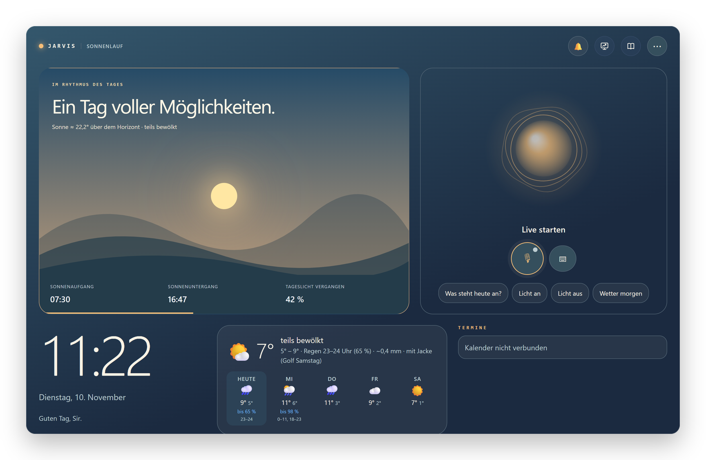
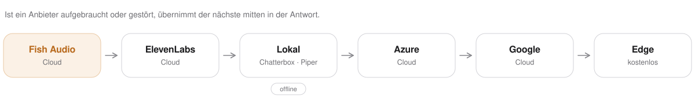
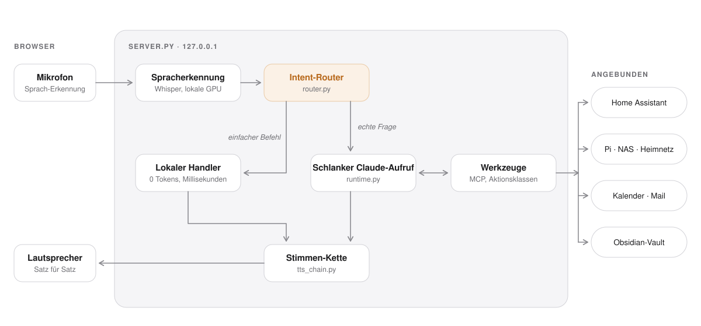
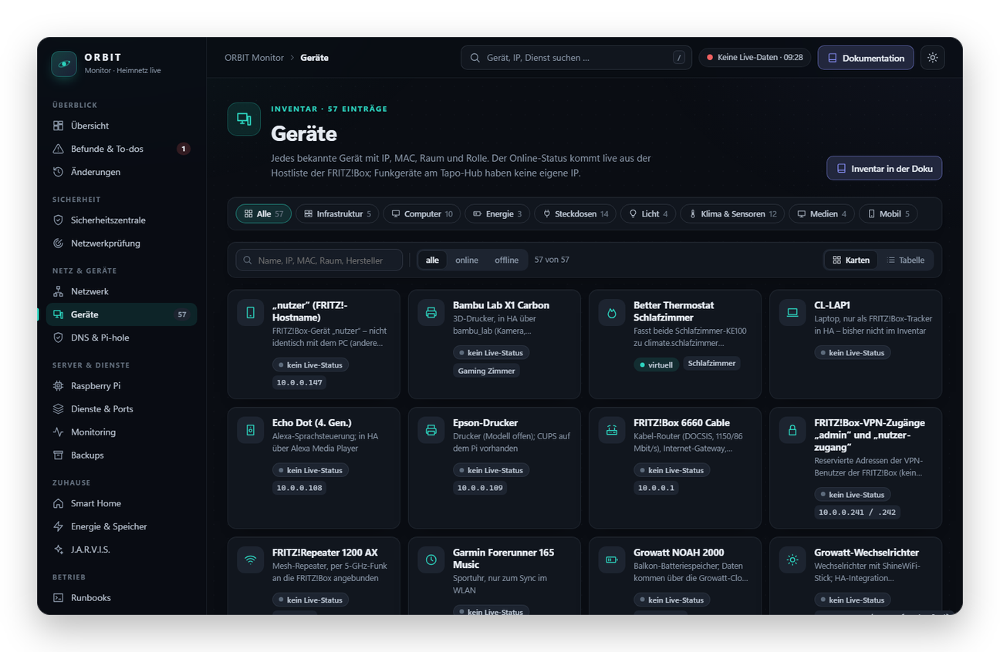
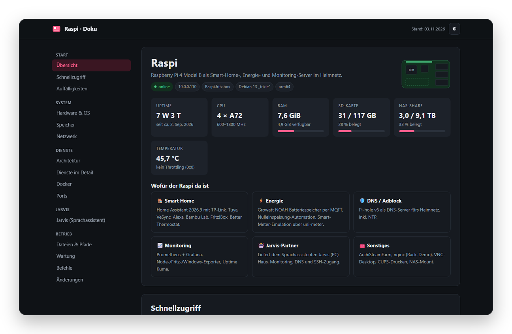

<p align="center">
  
</p>

<p align="center">
  <a href="docs/installation.md">Installation</a>&nbsp;&nbsp;·&nbsp;&nbsp;<a href="docs/funktionen.md">Funktionen</a>&nbsp;&nbsp;·&nbsp;&nbsp;<a href="docs/architektur.md">Architektur</a>&nbsp;&nbsp;·&nbsp;&nbsp;<a href="SECURITY.md">Sicherheit</a>&nbsp;&nbsp;·&nbsp;&nbsp;<a href="https://github.com/Zedas030/jarvis-hud">English</a>
</p>

Jarvis ist ein selbst gehosteter Sprachassistent im Stil des Iron-Man-Computers. Man spricht frei im Browser, er antwortet mit natürlicher Stimme, steuert das Smart Home, kennt Kalender, Postfach und Heimnetz, und er baut sich ein **dauerhaftes Gedächtnis** in einem Obsidian-Vault auf.

Das Sprachmodell ist die **Claude-Code-CLI** im Abo-Modus. Es gibt also keine API-Abrechnung pro Token. Damit das Kontingent lange reicht, beantwortet ein **lokaler Intent-Router** einfache Befehle komplett ohne LLM. Alles andere läuft als **schlanker, zustandsloser Aufruf** mit eigenem Kurz-Prompt und nur den Werkzeugen, die die Anfrage wirklich braucht.

<p align="center">
  
  <br>
  <sub>Das HUD am PC, Ansicht „Sonnenlauf“. Beispielkonfiguration, keine persönlichen Daten.</sub>
</p>

## Inhalt

- [Highlights](#highlights)
- [Was alles möglich ist](#was-alles-möglich-ist)
- [Bedienung](#bedienung)
- [Stimme: Anbieter-Kette, Sprach-Engine, Notbetrieb](#stimme-anbieter-kette-sprach-engine-notbetrieb)
- [Proaktiver Modus](#proaktiver-modus)
- [Gedächtnis und Lernen](#gedächtnis-und-lernen)
- [Sicherheitsmodell](#sicherheitsmodell)
- [Architektur](#architektur)
- [Schnellstart](#schnellstart)
- [Unterwegs: iPhone, iPad, Handy](#unterwegs-iphone-ipad-handy)
- [Projektstruktur](#projektstruktur)
- [Dokumentation](#dokumentation)
- [Raspberry Pi: Monitoring und Doku](#raspberry-pi-monitoring-und-doku)

## Highlights

<table>
<tr>
<td width="50%" valign="top"><br><b>Freihändig sprechen</b><br>Live-Mikrofon, Satzende-Erkennung, Reinreden unterbricht ihn. Aktivierungswort „Jarvis“ wahlweise lokal per openWakeWord.</td>
<td width="50%" valign="top"><br><b>0 Tokens für Alltägliches</b><br>Licht, Steckdosen, Musik, Timer, Wecker, Uhrzeit, Wetter: ein lokaler Intent-Router antwortet in Millisekunden, ohne LLM.</td>
</tr>
<tr>
<td valign="top"><br><b>Schlanke Claude-Aufrufe</b><br>Eigener Kurz-Prompt, nur die nötigen Werkzeuge, automatische Modellwahl. In Messungen über 25× weniger Tokens als ein Standard-Aufruf.</td>
<td valign="top"><br><b>Echtes Gedächtnis</b><br>Obsidian-Vault mit Themen-Notizen, Gesprächsprotokoll, Episoden je Tag, Ablaufdaten und Papierkorb. Jede Erinnerung mit prüfbarer Herkunft.</td>
</tr>
<tr>
<td valign="top"><br><b>Weiß, wo du bist</b><br>Präsenzmelder je Raum: Antwort aus dem Lautsprecher des Raums, „Licht an“ und „wärmer“ gelten für den Raum, Musik wandert mit, Heizung folgt, Morgen-Briefing beim ersten Gang ins Bad.</td>
<td valign="top"><br><b>Meldet sich selbst</b><br>Waschmaschine fertig, Zeit loszufahren, Paket kommt, Speicher voll, Unwetter, neues Gerät im WLAN. Mit Ruhezeiten, nie ohne Karte.</td>
</tr>
<tr>
<td valign="top"><br><b>Notbetrieb</b><br>Fällt Claude aus, übernimmt eine kostenlose Kette Groq → Gemini → Ollama mit denselben Werkzeugen. Die Stimme hat ihre eigene Kette aus Cloud-, GPU- und Gratis-Anbietern.</td>
<td valign="top"><br><b>Kontrolliert und ehrlich</b><br>Aktionsklassen im Code statt im Prompt, Bestätigungskarten, Schutz vor fremden Anweisungen in Mails und Webseiten, Audit-Log, Not-Aus, nur <code>localhost</code>.</td>
</tr>
<tr>
<td valign="top"><br><b>PC und Windows</b><br>Lautstärke, Apps, Bildschirmsperre, Fenster anordnen, Dateien und Zwischenablage, Bildschirmtext per lokaler OCR. Spotify wird leiser, solange Jarvis zuhört oder spricht.</td>
<td valign="top"><br><b>Heimnetz</b><br>Pi, NAS, FRITZ!Box, UniFi, Updates mit Freigabe-Karte, Wächter für neue Geräte. <i>„Lagebericht“</i> fasst Uptime Kuma, Sicherheitszentrale und Energie-Kreislauf zusammen.</td>
</tr>
</table>

## Was alles möglich ist

Die Architektur trennt **Router** (Regeln), **Werkzeuge** (MCP-Server) und **Gedächtnis** (Markdown). Neue Fähigkeiten lassen sich deshalb meist mit wenigen Zeilen ergänzen. Eine Auswahl, die vollständige Liste steht unter [Funktionen](docs/funktionen.md):

**Im Alltag**
- *„Guten Morgen“* liefert ein Tagesbriefing mit Wetter, Terminen, Energie, fast leeren Batterien und neuen Mails.
- *„Kann ich heute noch eine Runde laufen / golfen?“* ergibt eine Ampel aus Wetter, Wind, Tageslicht und Arbeitszeit.
- *„Trag mir Freitag um zehn den Zahnarzt ein“* (mit Bestätigung), *„Hab ich wichtige Mails?“*, *„Wann muss ich los?“* (Fahrzeit zum nächsten Termin), *„Kommt heute ein Paket?“*
- *„Timer 8 Minuten für die Pizza“*, *„Weck mich um 6:45“*, *„Erinnere mich morgen um 9 daran, Anna anzurufen“*, *„Setz Milch auf die Einkaufsliste“*. Lokal, ohne Tokens, übersteht Neustarts.
- *„Wenn ich Gute Nacht sage, mach alle Lichter aus und sag mir, wann der Wecker klingelt“* legt eine Routine an. Danach läuft *„Gute Nacht“* ohne LLM.

**Zuhause**
- *„Mach das Licht im Wohnzimmer auf 40 Prozent“*, *„Ist die Waschmaschine noch an?“*, *„Szene Kino“*, danach zwei Minuten lang *„heller“*, *„wieder aus“*, *„und im Schlafzimmer auch“*.
- Jarvis weiß über Präsenzmelder, in welchem Raum du bist: Antworten kommen aus dem Lautsprecher dort, *„Licht an“*, *„TV an“* und *„wärmer“* ohne Raum gelten für diesen Raum (bei unklarer Lage fragt er *„Wohnzimmer oder Schlafzimmer?“*), *„hol die Musik zu mir“* schiebt Spotify auf den Lautsprecher des Raums, die Heizung folgt dir, nachts sagt der Sonos gute Nacht.
- *„Sag im Wohnzimmer: Essen ist fertig“* spricht über den Echo Dot, im Schlafzimmer über den Sonos. Antworten wahlweise aus dem Echo, mit Alexas Stimme.
- *„Wie viel liefert die Solaranlage?“*, *„Was kostet mich der PC im Monat?“*, *„Wer zieht Standby-Strom?“*, *„Wann soll ich die Spülmaschine anmachen?“* (Energie-Coach aus Akkustand, Verbrauch und Sonnenvorhersage).
- Verlässt du die Wohnung und es läuft noch etwas, kommt ein Vorschlag „Ausschalten“ aufs Handy. Kommst du heim: *„Willkommen zurück. Während du weg warst: …“*
- Unwetterwarnungen des DWD von selbst, Routinen-Vorschläge aus deinen Gewohnheiten, *„Öffne Netflix auf dem Fernseher“* über Alexa am Fire TV.

**Technik und Netzwerk**
- *„Wie geht es dem Pi / dem NAS?“*, *„Ist ein unbekanntes Gerät im WLAN?“*, *„Wer ist gerade im WLAN?“* (UniFi), *„Gibt es Updates?“* (FRITZ!Box, NAS, Pi; installiert nur mit Karte).
- *„Lagebericht“*, *„Läuft die Nulleinspeisung?“*, *„Welche Sicherheitsbefunde sind offen?“* lokal aus Uptime Kuma, der ORBIT-Sicherheitszentrale und Home Assistant.
- *„Starte die Container auf dem Pi neu“* (ein Befehl per SSH, immer mit Bestätigungskarte), *„Wie weit ist der Drucker?“* (Bambu Lab), *„Was steht im Wartungskalender?“*

**Smarter im Alltag**
- *„Was habe ich dich letzte Woche zum Drucker gefragt?“* beantwortet der Router aus dem Gesprächsprotokoll. *„Wie war mein Schlaf, als ich das letzte Mal krank war?“* aus dem episodischen Gedächtnis.
- Fragst du an mehreren Tagen zur gleichen Zeit dasselbe, schlägt Jarvis samstags vor, es dir von selbst zu sagen. Schlechter Schlaf-Score oder hoher Stress (Garmin) machen den Vormittag „schonend“.
- *„Fokus 45 Minuten“* sammelt Meldungen statt sie zu sprechen. *„Was zahle ich für die Haftpflicht?“* sucht in der gescannten Post (Paperless). *„Serie auf dem Fernseher weiterschauen“* (Jellyfin).
- Ab 21 Uhr spricht er leiser und langsamer, in den Ruhezeiten flüstert er. Bei *„Mach Wohnzimmer an“* mit Lampe und Steckdose fragt er einmal nach und merkt sich die Antwort.

## Bedienung

| Aktion | So geht’s |
|---|---|
| Live-Modus | Klick auf **Live**. Der Button zeigt den Zustand: *Hört zu*, *Höre dich*, *Denkt*, *Spricht*. Mit Aktivierungswort: *Sag „Jarvis“*. |
| Push-to-Talk | Live-Button halten, sprechen, loslassen. |
| Unterbrechen | Einfach reinreden: Nach 150 ms hält er an und hört zu. Sagst du etwas, ist das die neue Frage; „Stopp“ beendet die Antwort. Sagst du nichts oder nur „mhm“, macht er mit dem angefangenen Satz weiter. |
| Timer und Wecker | Countdown oben in der Leiste. Es klingelt, dann spricht er. Reinreden, `Esc` oder **Stop** beendet das Klingeln, *„Schlummern“* gibt 9 Minuten. |
| Meldungen | Erscheinen mit gelbem Rand im Gespräch und werden vorgelesen; in den Ruhezeiten nur angezeigt. |
| Bestätigen | Karte anklicken oder „bestätigt“ / „nein“ sagen. Ein bloßes „ja“ zählt bewusst nicht. |
| Mini-Fenster | Verlässt du den Jarvis-Tab, steht unten rechts auf dem Desktop ein kleiner Roboter-Panda mit Zustand, letzter Zeile, **■ Stopp** und Mikrofon. |
| Ausgabe wählen | **Ton hier**, **Wo ich bin**, **Echo Wohnzimmer** oder **Sonos Schlafzimmer**: pro Gerät, wo die Antworten zu hören sind. |
| Tippen und Befehle | Eingabefeld, `Enter`. `/new`, `/status`, `/recall <Begriff>`, `/graph`, `/help` |
| Nachschlagen | Weiß Jarvis etwas nicht und steht es weder in den Notizen noch in den Werkzeugen, sucht er im Web. Private Daten kommen nie in die Suche. |

Mehr dazu, inklusive Persönlichkeitsprofilen, Windows-Steuerung, 3D-Drucker, Updates, Pakete und Postfächer: [Bedienung](docs/bedienung.md).

## Stimme: Anbieter-Kette, Sprach-Engine, Notbetrieb

<picture>
  <source media="(prefers-color-scheme: dark)" srcset="docs/assets/voice-chain-dark.svg">
  
</picture>

- **Ausfallsichere Stimme:** Jeder Anbieter ist ein Adapter. Ist einer erschöpft (Guthaben, Quota, ungültiger Key), wird er bis zum Reset übersprungen, auch über Neustarts hinweg. Bei einem vorübergehenden Fehler wechselt nur der aktuelle Satz den Anbieter, ohne hörbaren Abbruch. Das HUD zeigt den aktiven Anbieter mit Restguthaben.
- **Sprach-Engine auf dem Server:** Silero VAD, adaptives Satzende mit Teilergebnissen von Whisper, Unterbrechen in 150 ms, Weitersprechen am Satzanfang, wenn nur „mhm“ kam. Metriken je Durchgang für Grafana, Tuning in `config/voice.yaml`.
- **Lokal zuerst:** Spracherkennung mit Whisper (`large-v3-turbo` auf der GPU) und die GPU-Stimme laufen offline. Ab 21 Uhr leiser, in den Ruhezeiten geflüstert.
- **Notbetrieb:** Ist das Claude-Kontingent erschöpft oder bricht ein Aufruf ab, antwortet die erste verfügbare Stufe aus **Groq → Gemini → Ollama**, mit denselben Jarvis-Werkzeugen und Bestätigungskarten. Gemini sieht nie Mail, Kalender oder Gesundheit.

Details, Messwerte und das Tuning-Protokoll: [Stimme und Sprach-Engine](docs/sprache.md).

## Proaktiver Modus

Jarvis meldet sich von selbst – ausgelöst durch Ereignisse, nicht durch feste Uhrzeiten:

- **Heimkommen:** Kurz-Briefing in dem Raum, in dem dich die Präsenzmelder sehen – mit dem, was während deiner
  Abwesenheit passiert ist.
- **Morgens:** beim ersten Betreten des Bads nach der Nacht (Wetter, Warnungen, Termine, Pakete).
- **Sofort:** Wasser, Rauch, Unwetter, auseinanderlaufende NOAH-Akkus, ein Gerät offline.
- **„Jarvis, gute Nacht“:** Geräte noch an, offene Fenster, früher Termin morgen.

Jede Meldung ist *kritisch*, *wichtig* oder *nett zu wissen*. Ein Briefing ist höchstens 25 Sekunden lang, den
Rest zeigt das iPad. Schon Gesagtes wiederholt er erst, wenn sich etwas ändert; „Jarvis, mehr dazu“ liefert
Details.

**Er schweigt** – nur Kritisches kommt durch – in der Ruhezeit, bei „Ruhe für eine Stunde“ oder „heute keine
Ansagen“, im Gäste-Modus, während eines Telefonats oder Videocalls (PC-Mikrofon, iPhone-Fokus) und wenn du nicht
zu Hause bist. Sagst du öfter „unwichtig“, sinkt die Stufe dieser Meldungsart; das ist in der Glocke einsehbar
und zurücksetzbar. In Home Assistant gibt es die Schalter *Jarvis Proaktiv*, *Jarvis Gäste-Modus* und
*Jarvis Ruhe*.

Einrichten, alle Regeln, Quellen und Secrets: [Proaktiver Modus](docs/proaktiv.md). Ein- und ausschalten:
`config/proactive.yaml` → `enabled` (Vorlage `config/proactive.example.yaml`).

## Gedächtnis und Lernen

Der Vault ist ein Obsidian-Ordner mit Markdown-Notizen nach Themen (`Personen/Anna`, `Projekte/…`, `Geräte/…`), einem automatischen Gesprächsprotokoll und Episoden je Tag (Gespräche, Garmin, Meldungen, Ausfälle). Jarvis merkt und vergisst selbstständig (Ablaufdaten, Papierkorb), speichert nichts doppelt und überschreibt einen Widerspruch nie, sondern fragt nach. Jede Erinnerung hat eine prüfbare Herkunft.

- **Lernt dazu:** Formulierungen, die Claude einmal auflösen musste („Leselampe aus“), schaltet er danach selbst. Gleiche Fragen innerhalb von 5 Minuten kommen aus dem Zwischenspeicher. *„Verbrauchsbericht“* sagt, wie viel lokal lief.
- **Lernschleife:** Bewertet seine Gespräche selbst, schlägt sonntags feste Regeln vor, macht einen Wochenrückblick mit Mustern aus Schlaf, Schritten, Stress und Golf und schlägt zweimal pro Woche eine neue Fähigkeit vor.
- **Keine Arbeitsthemen:** Was nach Arbeit aussieht, wird weder protokolliert noch gespeichert (`privacy.py`).
- **Änderungen nur mit Karte:** Hintergrundjobs ändern nichts selbst. Sie legen einen Vorschlag ab, Jarvis erklärt ihn, und erst die Karte setzt ihn um.

Resource Manager, Context Engine, Task Engine, Dokumentensuche und die lernfähigen Module im Einzelnen: [Gedächtnis und Lernen](docs/gedaechtnis.md).

## Sicherheitsmodell

- **Nur lokal:** Der Server bindet an `127.0.0.1`. Jede Anfrage braucht ein pro Start erzeugtes Token, Host und Origin werden geprüft.
- **Fernzugriff nur gekoppelt:** Der Geräte-Port ist nur über `tailscale serve` erreichbar und zeigt ohne gekoppeltes Gerät nur die Kopplungsseite.
- **Aktionsklassen im Code:** Jedes Werkzeug hat eine Klasse (lesen, begrenzt schreiben, bestätigen, gesperrt); der Test schlägt fehl, wenn eins fehlt. Karten werden im Code erzwungen, nie nur im Prompt.
- **Bestätigungskarten:** Shell-Befehle, Kalender-Einträge, Schreiben außerhalb des Vaults. Ohne Antwort nach 75 s abgelehnt.
- **Fremde Inhalte:** Mail, Web, Kalender, Dateien, Zwischenablage und Bildschirm sind markierte, nicht vertrauenswürdige Daten und können keine Anweisungen geben.
- **Geschützte Geräte:** Router, PC, Server und Kühlschrank schaltet der Router nie selbst aus. Fragen schalten nie.
- **Kein Selbstumbau:** Zur Laufzeit gibt es keine Werkzeuge zum Bearbeiten von Code. Audit-Log und Not-Aus.
- **Daten bleiben lokal:** `.env`, `config/*.json`, `vault/`, `logs/`, `state.json` und Modelle stehen in `.gitignore`.

Die Regeln im Detail: [Sicherheitsmodell](docs/sicherheit.md) und [SECURITY.md](SECURITY.md).

## Architektur

<picture>
  <source media="(prefers-color-scheme: dark)" srcset="docs/assets/architecture-dark.svg">
  
</picture>

| Komponente | Aufgabe |
|---|---|
| `server.py` | HTTP-Server (nur `127.0.0.1`), HUD, API-Endpunkte, Bestätigungskarten, Verbrauchsprotokoll, Selbst-Neustart bei Codeänderungen |
| `router.py` | Intent-Router: lokale Handler, Wahl der Werkzeuggruppen und des Modells |
| `runtime.py` | Startet `claude -p` schlank (`--system-prompt`, `--tools`, `--strict-mcp-config`, `--no-session-persistence`) mit vorgewärmtem Prozess-Pool |
| `jarvis_mcp.py` | MCP-Server mit allen Werkzeugen in Gruppen, Bestätigungs-Schranke, Ergebnis-Obergrenze |
| `memory.py` · `episodes.py` | Vault → Wissensgraph, Kern-Erinnerungen, Protokoll, Episoden, Aufräumen |
| `voice_engine.py` · `voice_ws.py` | Full-Duplex-Sprach-Engine: Zustandsmaschine, Silero VAD, Satzende, Barge-in, Fortsetzen; WebSocket für Browser und Satelliten |
| `tts_chain.py` · `local_tts_server.py` | Sprachausgabe-Kette mit Adaptern, lokale GPU-Stimme in eigener Umgebung |
| `scheduler.py` · `watchers.py` · `events.py` | Timer, Wecker, Erinnerungen; Regeln für Meldungen von selbst; Push-Kanal zum HUD |
| `fallback_llm.py` | Notbetrieb: Ersatz-Kette Groq → Gemini → Ollama mit Jarvis-Werkzeugen |
| `policy.py` · `privacy.py` · `proposals.py` | Aktionsklassen, Arbeitsthemen-Filter, Vorschläge mit Karte |
| `ui/` | HUD (Vanilla JS, 3D-Wissensgraph ohne Abhängigkeiten), 19 Layouts pro Gerät |

**Effizienz:** Eigener Kurz-Prompt statt Claude-Code-Standard, Werkzeuggruppen nach Bedarf, automatische Modellwahl (Haiku/Sonnet), Antwort-Cache, Prozess-Pool. In Messungen braucht ein Aufruf **über 25× weniger Tokens** als ein Standard-Aufruf; was der Router kann, kostet nichts. Alle Komponenten und die Messung: [Architektur und Effizienz](docs/architektur.md).

## Schnellstart

**Voraussetzungen:** Windows 11 · Python 3.12 · Node.js · ein Claude-Abo. Optional: NVIDIA-GPU (CUDA 12.8) für Whisper `large-v3-turbo` und die lokale Stimme.

```powershell
# 1  Claude Code installieren und anmelden (Abo, kein API-Key)
npm.cmd install -g @anthropic-ai/claude-code
claude auth login

# 2  Python-Umgebung
py -3.12 -m venv .venv
.venv\Scripts\python.exe -m pip install -r requirements.txt
# mit NVIDIA-GPU zusätzlich: -r requirements-gpu.txt · auf dem Windows-PC: -r requirements-windows.txt

# 3  Konfiguration
copy .env.example .env                      # Werte eintragen
copy config\home.example.json config\home.json   # HA-Entity-IDs eintragen (optional)
mkdir vault\Erinnerungen

# 4  Start
start-jarvis.bat
```

Alle Einstellungen stehen kommentiert in [`.env.example`](.env.example); persönliche Daten gehören ausschließlich in `.env` und `config/*.json`, beide in `.gitignore`. Autostart, lokale Stimmen (Piper, Chatterbox auf der GPU), die Tabelle der Einstellungen sowie Entwicklung und Diagnose: [Installation und Konfiguration](docs/installation.md).

```powershell
.venv\Scripts\python.exe -m unittest discover -s tests      # alle Tests: ohne Haus, Claude, Netz und Ton
```

## Zugangsdaten und eigene Werte

Im Repo stehen keine echten Schlüssel, Passwörter oder Adressen. Alle Zugänge sind optional und gehören in
`.env` (Vorlage [`.env.example`](.env.example)), alle Geräte in `config/*.json` (Vorlagen
`config/*.example.json`). Beide sind in `.gitignore`. Die vollständige Tabelle aller Einstellungen steht in
[Installation und Konfiguration](docs/installation.md#konfiguration).

| Was | Wo der echte Wert hingehört |
|---|---|
| Stimme: `FISH_AUDIO_API_KEY`, `ELEVENLABS_API_KEY`, `AZURE_SPEECH_KEY`, `GOOGLE_TTS_API_KEY` | `.env` |
| Notbetrieb: `GROQ_API_KEY`, `GEMINI_API_KEY`, `OLLAMA_URL` | `.env` |
| Home Assistant: `HA_URL`, `HA_TOKEN`, `HA_MCP_URL` | `.env`; Entitäten für Dashboard, Räume und Geräte in `config/home.json` |
| Mail und Kalender: `ICLOUD_USER`, `ICLOUD_APP_PASSWORD`, `MAIL_IMAP_HOST`, `MAIL_USER`, `MAIL_PASSWORD` | `.env`, bei iCloud ein App-spezifisches Passwort |
| Heimnetz: `PIHOLE_URL`, `PIHOLE_PASSWORD`, `PROMETHEUS_URL`, `KUMA_URL`, `SYNOLOGY_*`, `UNIFI_*`, `JELLYFIN_*`, `PAPERLESS_*`, `JARVIS_PI_HOST`, `JARVIS_PI_USER` | `.env` |
| Sonstiges: `DHL_API_KEY`, `GARMIN_EMAIL`, `GARMIN_PASSWORD`, `JARVIS_SPOTIFY_CLIENT_ID` | `.env`; Spotify danach einmal mit `scripts\spotify_login.py` anmelden |

Für die Veröffentlichung wurden persönliche Werte so ersetzt:

| Anonymisiert | Im Repo | Eigener Wert |
|---|---|---|
| Name | „Nutzer“ | `JARVIS_USER_NAME` in `.env` |
| Wohnort, Koordinaten, Warnzelle | „Musterort“, „Musterstadt“, `000000000` | `JARVIS_PLACE`, `JARVIS_WEATHER_LAT`, `JARVIS_WEATHER_LON` in `.env` |
| Adressen im Heimnetz | `10.0.0.x` als Beispiel in Kommentaren und Standardwerten | die passende `*_URL`- bzw. `*_HOST`-Variable in `.env`. Die Links zu Monitoring und Doku stehen fest in `ui/index.html` und werden dort angepasst. |
| Tailscale-Namen | `…tailxxxx.ts.net` | `JARVIS_REMOTE_HOSTS` in `.env` |
| Spotify-Konto, Client-ID | `nutzer`, `xxxxxxxx` | eigene App auf developer.spotify.com, ID in `.env` |
| Geräte- und Raumnamen | Beispiele in `config/*.example.json` | eigene Kopien ohne `.example` |

Der Ordner `pi/` ist ein Schnappschuss von Monitoring-Seite und Pi-Doku mit denselben Platzhaltern. Er
dient als Anschauung und wird nicht automatisch ausgeliefert.

## Unterwegs: iPhone, iPad, Handy

Der PC bleibt das Gehirn. iPhone und iPad greifen über **Tailscale** per HTTPS zu, von überall und ohne offenen Port im Router: `JARVIS_REMOTE=1`, einmal `tailscale serve --bg 8721`, dann die Adresse auf dem Gerät zum Home-Bildschirm legen und mit einem sechsstelligen Code koppeln. Das iPad zeigt ein eigenes Raum-Display mit Kacheln (Wetter, Haus, Energie, Tokens), das iPhone das HUD im Hochformat; Tippen auf das Mikrofon schaltet Live, Gedrückthalten ist Push-to-Talk. Vorschläge beim Verlassen der Wohnung und vor dem Losfahren kommen mit **Ja/Nein-Knöpfen** aufs Handy (Home-Assistant-App), die Antwort zählt wie die Karte. Einrichtung Schritt für Schritt: [Bedienung → Unterwegs](docs/bedienung.md#unterwegs-iphone-und-ipad).

## Projektstruktur

```
├─ server.py           Start (Supervisor + HTTP-Server), lädt paths.py
├─ jarvis/
│  ├─ core/            router · runtime · commands · events · scheduler · context · tasks · focus · whereabouts
│  ├─ safety/          policy · privacy · audit · emergency · proposals
│  ├─ tools/           jarvis_mcp (Werkzeug-Server) · desktop · infra · pc · lists · routines · devices ·
│  │                   commute · parcels · icloud_calendar · spotify · speakers · paperless · unifi · jellyfin …
│  ├─ memory/          memory · memory_intel · learning · skill_factory · answer_cache · episodes · docsearch
│  ├─ voice/           voice_engine · voice_ws · voice_vad · tts_chain · local_tts_server · wakeword · sonos · alexa_voice
│  ├─ llm/             fallback_llm · resources
│  └─ watch/           watchers · briefing · weekly_review · energy_coach · departure · weather_alerts · wellbeing …
├─ ui/                 HUD: index.html · app.js · voice-client.js · graph.js · styles.css · pair.html
├─ config/             *.example.json (eigene Dateien bleiben lokal) · voice.yaml
├─ docs/               Handbuch in Kapiteln · screenshots/
├─ pi/                 Monitoring und Doku des Raspberry Pi (anonymisierte Kopien)
├─ tests/              ein Testmodul pro Bereich, isolate.py zuerst
└─ scripts/            measure_tokens · router_report · fetch_voice_models · install-ha-remote.ps1 …
```

## Dokumentation

| Seite | Inhalt |
|---|---|
| [Funktionen](docs/funktionen.md) | Alle Highlights, alles was möglich ist, Funktionsliste |
| [Installation und Konfiguration](docs/installation.md) | Schnellstart, lokale Stimmen, alle `.env`-Einstellungen, Entwicklung und Diagnose |
| [Bedienung](docs/bedienung.md) | Sprechen und tippen, Karten, Persönlichkeit, Alltag, Windows, iPhone/iPad, Handy |
| [Stimme und Sprach-Engine](docs/sprache.md) | Anbieter-Kette, Zuhören/Unterbrechen/Weitersprechen mit Messwerten, Notbetrieb |
| [Proaktiver Modus](docs/proaktiv.md) | Auslöser, Schweige-Regeln, Quellen, Sprachbefehle, Feedback, Secrets, Linux |
| [Gedächtnis und Lernen](docs/gedaechtnis.md) | Ressourcen, Kontext, Aufgaben, lernfähige Module, Vault |
| [Architektur und Effizienz](docs/architektur.md) | Alle Komponenten, Router und schlanker Modus, Projektstruktur |
| [Sicherheitsmodell](docs/sicherheit.md) | Die Regeln im Code; Details in [SECURITY.md](SECURITY.md) |
| [ARCHITECTURE.md](ARCHITECTURE.md) · [SECURITY.md](SECURITY.md) · [ROADMAP.md](ROADMAP.md) | Modulkarte, Sicherheitsregeln und Ausbauplan für die Arbeit am Code |
| [pi/](pi/README.md) | Monitoring und Doku des Raspberry Pi, der Jarvis das Haus, das Netz und DNS liefert |

## Raspberry Pi: Monitoring und Doku

Der Pi im Heimnetz liefert Jarvis Home Assistant, DNS und das Monitoring; das HUD verlinkt beide Seiten oben rechts. Die Kopien unter [`pi/`](pi/README.md) sind anonymisiert.

<table>
<tr>
<td width="50%"></td>
<td width="50%"></td>
</tr>
<tr>
<td align="center"><sub>ORBIT Monitor (Port 8092): Geräteinventar mit Live-Status</sub></td>
<td align="center"><sub>Pi-Dokumentation (Port 8091): Hardware, Dienste, Abschnitt Jarvis</sub></td>
</tr>
</table>

<sub>Ursprünglich inspiriert von <a href="https://github.com/Itsme23476/jarvis-claude-code">jarvis-claude-code</a>. Für eine eigenständige Weitergabe vorher die Lizenzlage der Vorlage klären.</sub>
